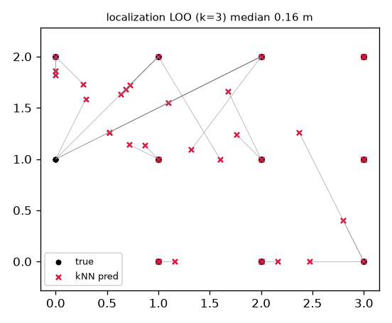
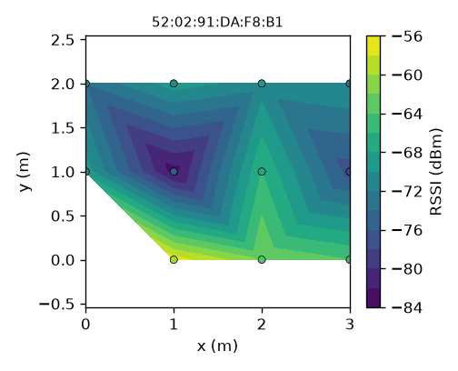
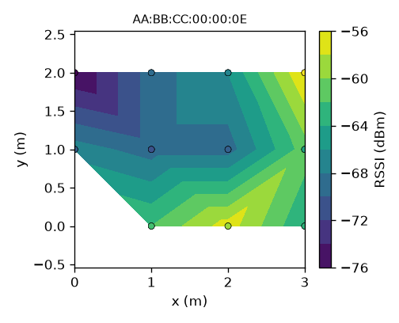

# WiFi Radio Mapping

**Indoor mapping and localization from WiFi signal strength alone - no camera, no
lidar, running on cheap ESP8266 boards.** This is stage one of a camera-free
autonomous-car idea: first teach a robot to *see the room with radio*, then
localize in it, then drive.



GPS does not work indoors. WiFi is everywhere, and the strength of each access
point's signal forms a fingerprint that changes with position. This project
measures that fingerprint with two NodeMCU ESP8266 boards and turns it into a map
a robot can navigate.

## Hardware

| Role | Board | Firmware |
| --- | --- | --- |
| **Board A** - sensor | ESP8266 (NodeMCU, 4 MB) | `wifi_mapper` - ambient scan + single-transmitter promiscuous sniff |
| **Board B** - reference | ESP8266 (NodeMCU) | `ref_beacon` - fixed soft-AP (`mq-ref`, ch 6) at a known spot |
| Compute | any laptop | Python capture + analysis |

Total cost: two boards that were already on hand. No new hardware bought.

## The first real experiment

A floor-tile grid in a room: Board B fixed at a tile intersection = origin
`(0,0)`, Board A carried to 11 points. Coordinates in tiles (the path-loss
exponent is scale-invariant, so tiles are fine).

`mq-ref` median RSSI per point (dBm):

| y\x | 0 | 1 | 2 | 3 |
| --- | --- | --- | --- | --- |
| 0 | - | -60 | -64 | -66 |
| 1 | -71 | -81 | -68 | -79 |
| 2 | -73 | -72 | -70 | -74 |

**What it shows**

- **Fingerprint localization works**: kNN leave-one-out median error **0.16 tiles**
  (p90 1.41). Small grid, so optimistic - but the pipeline is sound.
- **Pure distance ranging does not**: the fitted path-loss exponent is **n = 0.77**
  (real indoor values are 2-4). RSSI here is dominated by obstacles and
  direction, not distance - so fingerprint matching, not trilateration, is the
  right tool.
- **Real shadowing exists**: `(1,1)` = -81 dBm and `(3,1)` = -79 dBm are deep
  fades relative to neighbours, i.e. obstacles between the beacon and those
  points. That structure is what a geometric map can be built from.

RSSI heatmaps (left: reference beacon, right: a home router):

| mq-ref | home-router |
| --- | --- |
|  |  |

## How it works

```
Board B: ref_beacon (fixed AP)          Board A: wifi_mapper (sensor)      Laptop
  known position, ch 6, max TX   )))     scan + promiscuous sniff   ---->   capture -> JSONL
                                                                                 |
                                                                                 v
                                                                     analyze -> fingerprint map
                                                                              -> heatmaps
                                                                              -> kNN localization (LOO error)
                                                                              -> path-loss fit vs ref
                                                                              -> k-wall geometry sketch
```

- The sensor streams line-delimited JSON over USB serial (RSSI, BSSID, channel
  per AP; and per-packet RSSI when sniffing one transmitter).
- The host builds an RSSI feature matrix, matches live vectors to known points
  (localization), fits a path-loss model against the reference beacon, and
  partitions RSSI into wall-count `k` thresholds (Structure-from-WiFi style).
- ESP8266 exposes **RSSI only** (no CSI), which is the constraint the design
  works within.

## Repository layout

- `docs/` - hardware profile, prior-art survey, architecture + serial protocol, measured results.
- `firmware/` - Arduino sketches: `wifi_mapper` (sensor) and `ref_beacon` (reference AP).
- `host/wifi_map/` - Python package: `capture`, `point`, `sessions`, `analyze`, `geometry`, `simulate`, `report`.
- `tools/` - flash helper and the unlazy gate checks.
- `GATES.md` - the completion ledger (all gates met on real hardware).

## Reproduce

```bash
# host env
python3 -m venv .venv
.venv/bin/pip install -r host/requirements.txt

# no board needed - full pipeline on synthetic data
PYTHONPATH=host .venv/bin/python -m wifi_map.simulate --out data/derived/sim --points 8
PYTHONPATH=host .venv/bin/python -m wifi_map.analyze  --session data/derived/sim

# with boards: flash, then survey point by point, then report
./tools/flash.sh /dev/cu.usbserial-0001 firmware/wifi_mapper
PYTHONPATH=host .venv/bin/python -m wifi_map.point 1 0
PYTHONPATH=host .venv/bin/python -m wifi_map.analyze --session data/sessions/room1 \
  --ref 52:02:91:DA:F8:B1,0,0
PYTHONPATH=host .venv/bin/python -m wifi_map.report --dir data/derived/room1
```

## Roadmap

- **P0 sensing** (done) - scan + sniff firmware, capture, protocol.
- **P1 fingerprint map** (done) - grid survey, heatmaps, kNN localization, honest error.
- **P2 geometry** - turn RSSI shadowing into a coarse free-space / occupancy grid.
- **P3 motion** - dense RSSI-vs-time while moving; continuous localization; WiFi + odometry SLAM.
- **P4 robot** - planner + controller, with one cheap proximity sensor for the last-centimetre collision avoidance.

## Honest limitations

- RSSI is noisy and environment-dependent; expect ~1-2 m accuracy at best, and
  only inside a surveyed area.
- WiFi gives **position and a coarse layout**, not centimetre geometry. Heading
  and fine motion need odometry/IMU; last-metre collision avoidance needs a cheap
  proximity sensor. Camera-free yes; WiFi-only for collision, no.
- The ESP8266 cannot capture CSI (that needs an ESP32).
- Current surveys are USB-tethered (no on-board logging yet).

## Where help is welcome

The open problems, in rough priority:

1. **Continuous moving localization** - log RSSI along a walk and measure error
   over time, not just at static points. The decisive test for "can it drive".
2. **Occupancy geometry** - implement inverse k-visibility (Structure from WiFi)
   to draw walls/free space from RSSI + trajectory.
3. **Multi-anchor** - more fixed transmitters at known positions.
4. **Untethered logging** - log scans to the ESP8266's flash so the sensor can
   roam on a power bank.
5. **Anchor-free SLAM** - GP-LVM / GraphSLAM over RSSI (see references).

Issues and PRs welcome.

## Prior art

- Ferris, Fox, Lawrence - *WiFi-SLAM using Gaussian Process Latent Variable Models* (IJCAI 2007).
- Kim et al. - *Structure from WiFi (SfW): RSSI-based Geometric Mapping* (arXiv 2403.02235, 2024).
- Fafoutis et al. - *An RSSI-based wall prediction model* (WF-IoT 2015).
- Huang et al. - *Efficient, Generalized Indoor WiFi GraphSLAM* (ICRA 2011).
- `espressif/esp-csi` - CSI-based sensing (ESP32 only).

See `docs/research.md` for the full survey.
